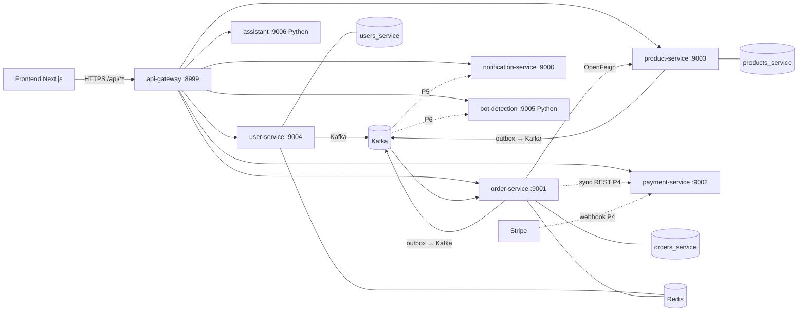
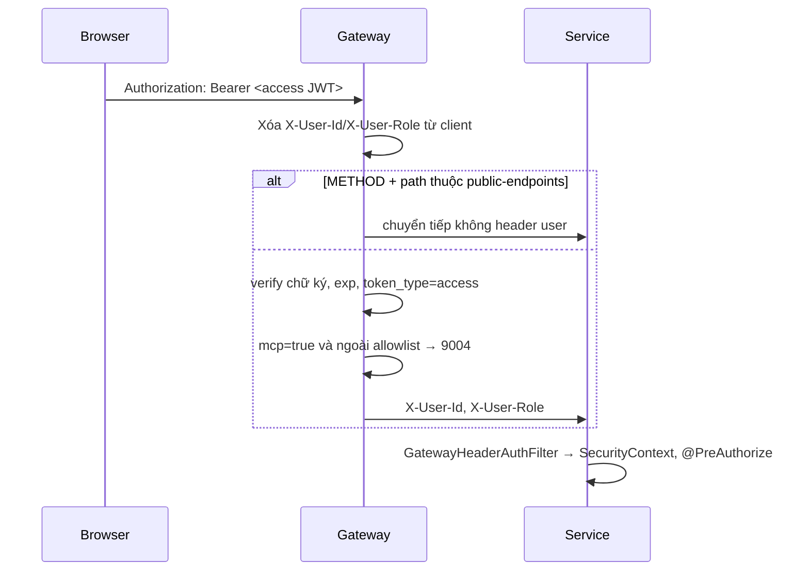

# Vantix — Kiến trúc hệ thống

> Tài liệu tổng hợp theo code tại nhánh `feature/order-service` (13/11/2026). Chi tiết từng phase nằm ở `docs/`. Khi code và tài liệu lệch nhau, code là sự thật.

## 1. Tổng quan



Nét liền: đã có trong code. Nét đứt: thiết kế, chưa code.

## 2. Service

| Service | Port | DB | Trách nhiệm | Trạng thái |
|---|---|---|---|---|
| api-gateway | 8999 | — | Entry point, verify JWT, inject `X-User-Id`/`X-User-Role`, CORS, routing | Có |
| user-service | 9004 | `users_service` | Đăng ký, OTP email, login, refresh rotation, Google OAuth2, tạo STAFF | Có (P1) |
| product-service | 9003 | `products_service` | Catalog: venue, event, seat map/seat, ticket type, giá gốc | Có (P2) |
| order-service | 9001 | `orders_service` | Giỏ, hold, tồn kho giao dịch, availability, nhận kết quả thanh toán, tính % hoàn; sau này vé/QR, check-in | Có (P3, P4) |
| payment-service | 9002 | `payments_service` | Stripe Checkout session, webhook, refund — chỉ biết tiền | Có (P4, chưa chạy với Stripe thật) |
| notification-service | 9000 | `notifications_service` | Consume Kafka, gửi email, WebSocket, bảng `notifications` | Khung rỗng |
| bot-detection | 9005 | — | Isolation Forest chấm điểm `cart.item_added` | Chỉ `/health` |
| assistant | 9006 | — | Trợ lý LLM, stateless | Chỉ `/health` |

Service Java đều có `server.servlet.context-path: /api`. Gateway route theo prefix: `/api/users/**, /api/auth/**, /api/oauth2/**, /api/login/oauth2/**` → user; `/api/events/**, /api/venues/**, /api/ticket-types/**, /api/products/**` → product; `/api/orders/**` → order; `/api/payments/**`, `/api/notifications/**`, `/api/bot-detection/**`, `/api/assistant/**`.

## 3. Common-lib (rule of 3)

| Artifact | Nội dung | Dùng bởi |
|---|---|---|
| `commonlib-api-response` | `ApiResponse<T>`, `ErrorCode`, `CommonErrorCode` (1xxx), `AppException`, `BaseGlobalExceptionHandler` | Mọi service Java |
| `commonlib-security` | `GatewayHeaderAuthFilter`, `SecurityUtils` (servlet) | user, product, order |
| `commonlib-jwt` | `JwtUtils`, `JwtClaims`, `JwtProperties` | user (phát hành), gateway (verify) |
| `commonlib-kafka` | `KafkaProducerConfig` (idempotent producer, `JacksonJsonSerializer`), `KafkaTopics`, event record | user, product, order |

## 4. Xác thực — Trust-The-Gateway



- Access token 15 phút, refresh token 7 ngày (JWT `token_type=refresh`, DB lưu SHA-256, rotation + reuse detection theo `family_id`) trong cookie `httpOnly; Path=/api/auth`.
- Phân quyền bằng `@PreAuthorize` ở method để lỗi 403 đi qua `GlobalExceptionHandler`.
- Mã lỗi Gateway: 9001 thiếu token, 9002 sai token, 9003 hết hạn (frontend chỉ tự refresh khi 9003), 9004 bắt buộc đổi mật khẩu.

## 5. Dữ liệu

| DB | Bảng chính | Migration |
|---|---|---|
| `users_service` | `users` (partial unique email khi `deleted_at IS NULL`), `refresh_tokens` | V1, V2 |
| `products_service` | `venues`, `events`, `seat_maps`, `seats`, `ticket_types`, `event_outbox` | V1–V3 (V2 seed event) |
| `orders_service` | `orders`, `order_items`, `holds`, `ticket_inventory`, `cancelled_events`, `idempotency_keys`, `order_event_outbox` | V1 |

Redis: `otp:{purpose}:{userId}`, `otp:cooldown:{purpose}:{userId}`, `oauth:code:{code}` (user); `order:hold:seat:{seatId}`, `order:hold:ga:{holdId}` (order).

## 6. Kafka

| Topic | Producer | Consumer | Cơ chế publish |
|---|---|---|---|
| `user.email-verification-requested` | user | notification (P5, chưa có) | Sau commit `TransactionTemplate`, lỗi chỉ log |
| `user.forgot-password-requested` | user | notification (P5) | Như trên |
| `user.staff-account-created` | user | notification (P5) | Như trên — payload có mật khẩu tạm, không log |
| `product.event-cancelled` | product | order | Transactional outbox `event_outbox`, retry 5s |
| `cart.item_added` | order | bot-detection (P6) | Transactional outbox `order_event_outbox`, retry 5s |
| `order.refund-requested` | order | payment | Outbox `order_event_outbox` (cột `topic` + `payload`) |
| `payment.succeeded`, `payment.failed` | payment | order | Outbox `payment_event_outbox` |
| `refund.completed`, `refund.failed` | payment | order | Outbox `payment_event_outbox` |

Key = id aggregate. Consumer phải idempotent vì outbox có thể phát lặp.

Luồng tiền (P4, chi tiết `docs/payment/`): buyer gọi Order `POST /orders/{id}/checkout` → Order gọi Payment đồng bộ qua API nội bộ `/api/internal/payments/**` (không route ở Gateway) lấy link Stripe Checkout → Stripe gọi webhook `/api/payments/webhooks/stripe` (xác thực chữ ký, idempotent theo event id) → `payment.succeeded` → Order `PAID`. Tiền vào khi Order đã hết hạn/bị hủy thì hoàn 100%. Hoàn tiền: Order tính % và phát `order.refund-requested`, Payment thực thi qua Stripe.

## 7. Order — chống bán trùng (P3)

```mermaid
sequenceDiagram
    participant FE
    participant O as order-service
    participant P as product-service
    participant R as Redis
    participant DB as orders_service
    FE->>O: POST /orders (Idempotency-Key)
    O->>DB: replay theo (buyer, operation, key)? → trả kết quả gốc
    O->>P: GET /events/{id}, /seat-map (Feign, fail closed → 4010)
    O->>O: validate sales window, category, seat, quantity
    O->>DB: BEGIN; reuse/insert CART (partial unique buyer+event)
    O->>R: SET NX order:hold:seat:{id} TTL
    O->>DB: insert hold (unique seat khi HELD/CONFIRMED/PURCHASED)
    O->>DB: GA: UPDATE ticket_inventory WHERE held+sold+n <= total
    O->>DB: insert idempotency_keys + order_event_outbox; COMMIT
    O-->>FE: 201 Order (holdExpiresAt = hold đầu + 10 phút)
```

- Lớp 1 — **Idempotency key** (OR01/OR04/OR06): chống retry cùng client.
- Lớp 2 — **Redis TTL**: chặn nhanh ghế đang giữ, tín hiệu hết hạn.
- Lớp 3 — **PostgreSQL**: `uq_holds_active_seat`, `uq_orders_buyer_event_cart`, CHECK `held + sold <= total`, update có điều kiện. Đây là lớp quyết định.
- Hết hạn: `OrderExpirationScheduler` mỗi 1 giây + expire khi đọc; nhả tồn đúng một lần.
- State: Order `CART → PENDING_PAYMENT → (PAID → TICKETS_ISSUED ở P4)`, hoặc `EXPIRED`/`CANCELLED`. Hold `HELD → CONFIRMED → PURCHASED`, hoặc `RELEASED`/`EXPIRED`.
- Availability public (`GET /orders/events/{id}/availability`) để UI ghép với seat map tĩnh của Product, refetch 15 giây.

## 8. Frontend

`frontend/src/app`: `(auth)` login/register/verify/forgot/reset/auth-callback; `(main)` discovery, event detail, seat map, orders, profile, 403/500; `(admin)` events, venues. API client `src/lib/api` serialize refresh (một request refresh duy nhất), access token chỉ giữ trong bộ nhớ (Zustand `auth-store`).

## 9. Hạ tầng & CI

- `docker-compose.yml`: postgres, pgAdmin, redis, RedisInsight, kafka (KRaft), kafka-ui. `docker-compose.prod.yml` và `Dockerfile` gốc còn rỗng.
- GitHub Actions `ci.yml`: phát hiện thay đổi theo thư mục, commitlint, backend `mvn clean verify`, frontend lint + `tsc --noEmit` + build.
