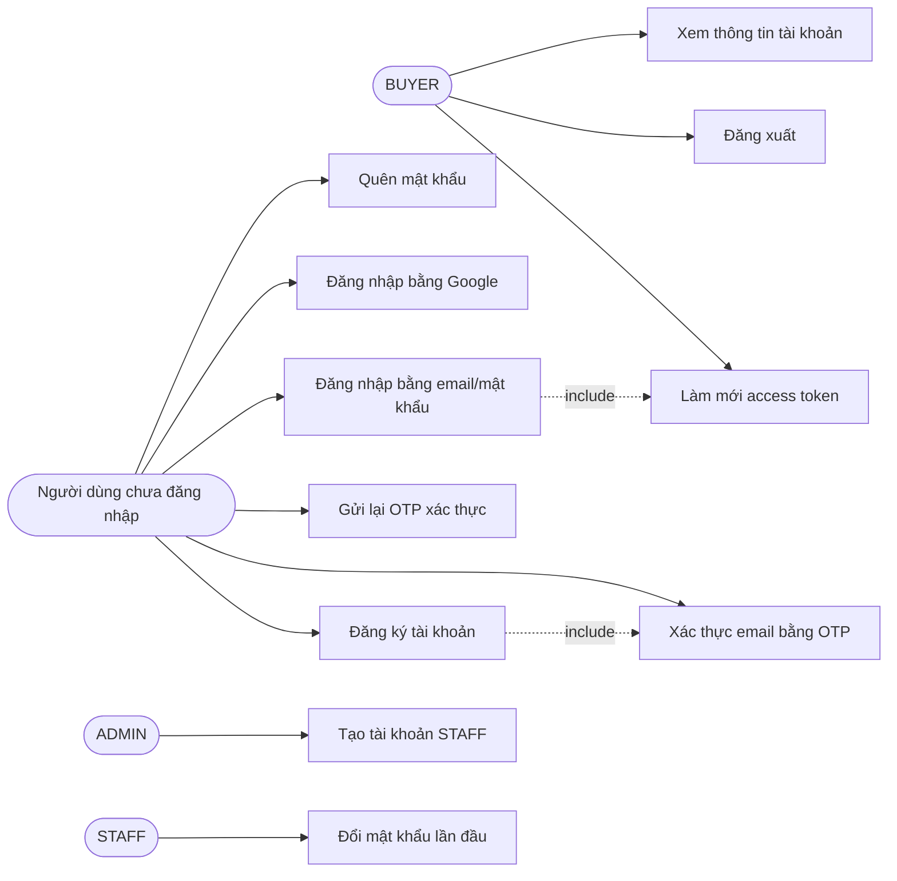
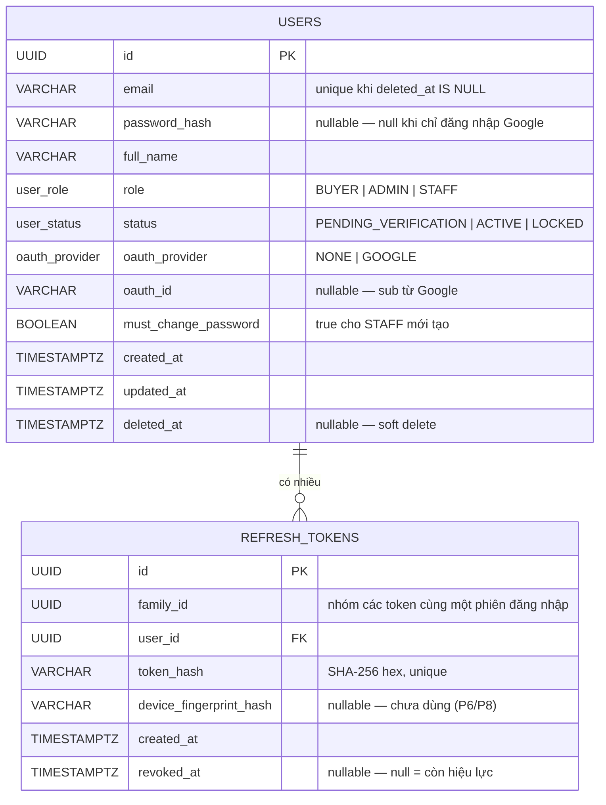
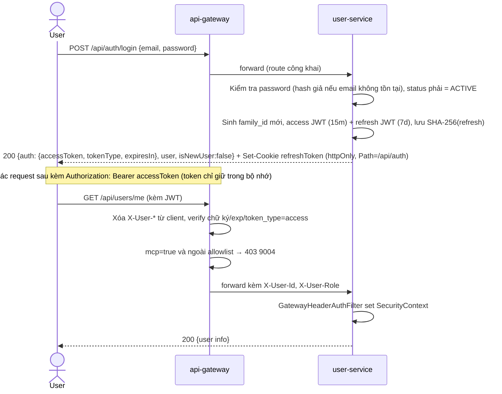
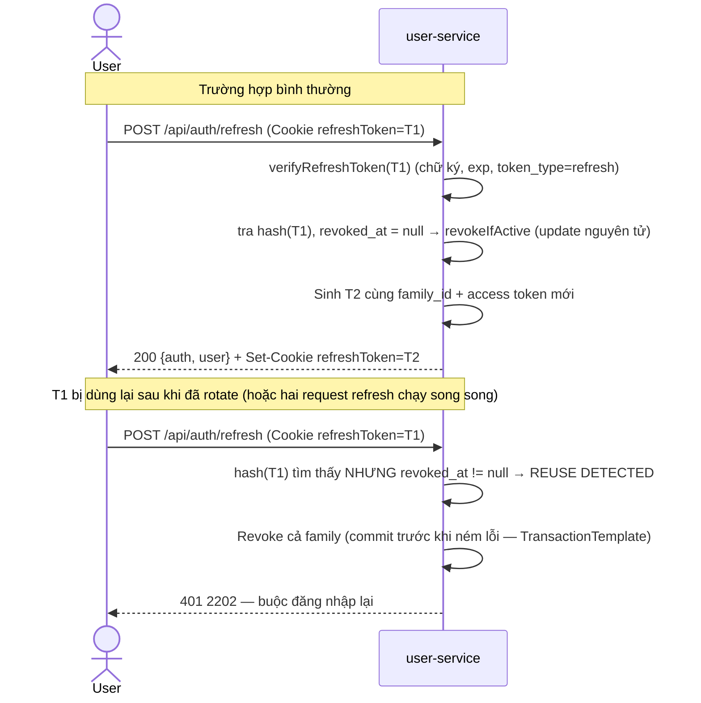
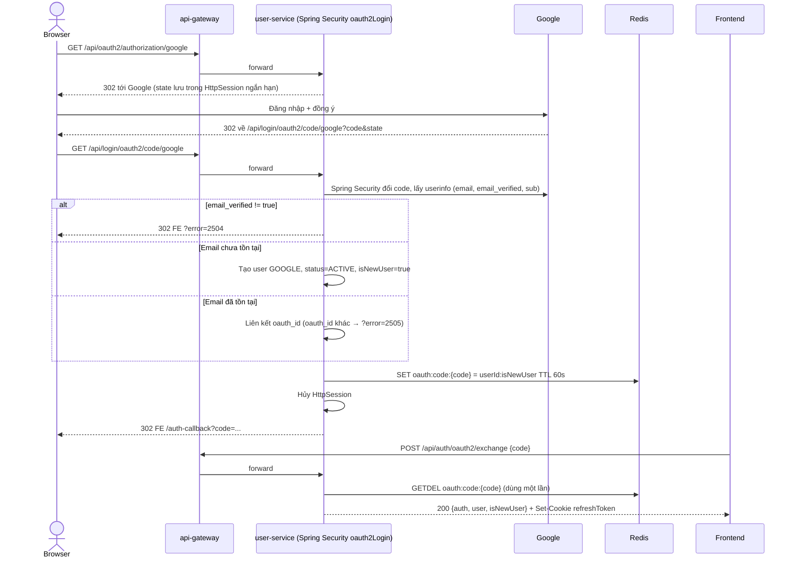
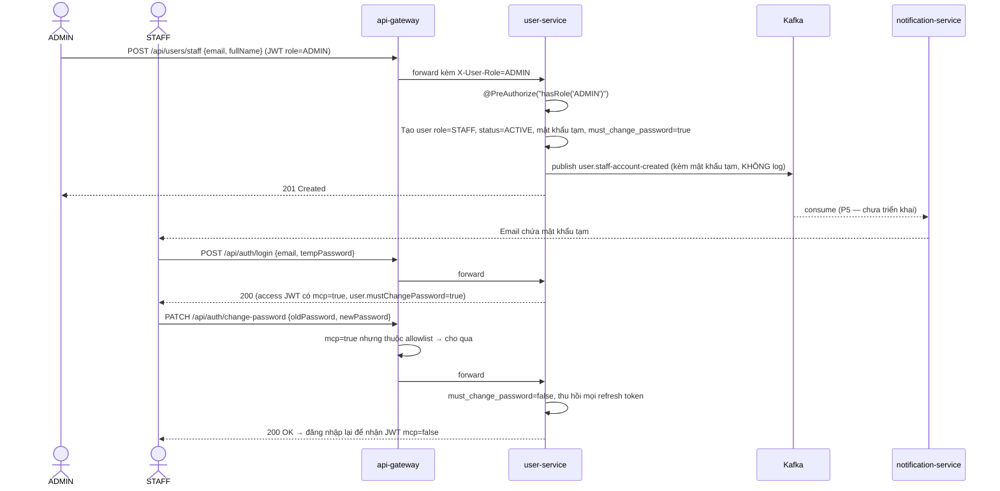
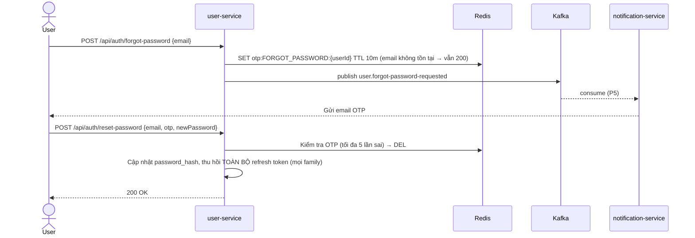

# Vantix — Phase 1: User & Auth — Tài liệu thiết kế

> **Trạng thái:** Đã triển khai. Cập nhật 13/11/2026 theo code `user-service`/`api-gateway` và mục 0 của `P1_auth_api_design.md` (OTP chuyển Redis, refresh token JWT trong cookie, OAuth2 qua Spring Security + exchange). Chi tiết request/response/lỗi: `P1_auth_api_design.md`.
> **Liên quan:** `../00_roadmap_phases_v1.md` (mục P1), `../P0_infrastructure_summary.md`

---

## 1. Quyết định thiết kế đã chốt (bối cảnh cho các phần sau)

| # | Quyết định |
|---|---|
| 1 | Refresh token dùng **rotation + reuse detection theo family** (mục 4.3). Refresh token là JWT (`token_type=refresh`), DB chỉ lưu SHA-256 hash; đi bằng cookie `httpOnly`, `Path=/api/auth` |
| 2 | Email chưa xác thực → `status = PENDING_VERIFICATION`, **chặn đăng nhập** hoàn toàn; có API gửi lại OTP |
| 3 | OAuth2 Google xử lý trong `user-service` bằng `oauth2Login()` của Spring Security; sau khi Google xác thực, `user-service` **tự phát hành JWT hệ thống** qua bước đổi one-time code; tài khoản qua Google coi như đã xác thực email |
| 4 | ADMIN tạo tài khoản STAFF → hệ thống sinh **mật khẩu tạm**, gửi qua email (Kafka → Notification), STAFF bắt buộc đổi mật khẩu (claim `mcp=true`, Gateway chỉ cho gọi allowlist) |
| 5 | Quên mật khẩu dùng chung pattern OTP-qua-email như xác thực đăng ký |
| 6 | Mô hình JWT: Gateway verify, inject `X-User-Id`/`X-User-Role`; service downstream dùng `GatewayHeaderAuthFilter` (`commonlib-security`), không tự verify JWT |
| 7 | OTP lưu ở **Redis** với TTL (bỏ bảng `USER_OTP`), hash `HMAC-SHA256` |

---

## 2. Use case tổng quát



**Ghi chú:** SELLER chưa có ở Phase 1. ADMIN đầu tiên, 1 STAFF và 5 BUYER mẫu được seed khi khởi động (`ApplicationRunConfig`, xem API design mục 7).

---

## 3. ERD



**Ghi chú thiết kế:**
- Migration: `V1__init_users_schema.sql` (role/status/provider là PostgreSQL enum), `V2__delete_col_expried_at.sql` bỏ `refresh_tokens.expires_at` — hạn dùng do claim `exp` của JWT quyết định.
- `email` unique bằng partial index `idx_users_email ... WHERE deleted_at IS NULL`; `(oauth_provider, oauth_id)` unique khi provider khác `NONE`.
- **Bảng `USER_OTP` đã bỏ.** OTP là dữ liệu tạm có thời hạn, lưu Redis:

| Khóa Redis | Giá trị | TTL |
|---|---|---|
| `otp:{purpose}:{userId}` | JSON `{otpCodeHash, attemptCount}` | 10 phút |
| `otp:cooldown:{purpose}:{userId}` | `"1"` | 60 giây |
| `oauth:code:{code}` | `"{userId}:{isNewUser}"` | 60 giây |

Đánh đổi: khóa hết hạn biến mất nên không phân biệt "hết hạn" với "chưa từng có" (gộp lỗi 2301) và không còn audit lịch sử OTP.

---

## 4. Sequence diagram — các luồng chính

### 4.1 Đăng ký + xác thực email

```mermaid
sequenceDiagram
    actor U as User (Guest)
    participant GW as api-gateway
    participant US as user-service
    participant R as Redis
    participant K as Kafka
    participant N as notification-service

    U->>GW: POST /api/auth/register
    GW->>US: forward (route công khai)
    US->>US: Tạo user, status=PENDING_VERIFICATION (TransactionTemplate)
    US->>R: SET otp:EMAIL_VERIFICATION:{userId} = {HMAC(otp), 0} TTL 10m + cooldown 60s
    US->>K: publish user.email-verification-requested (sau commit, lỗi chỉ log)
    US-->>U: 201 Created
    K-->>N: consume event (P5 — chưa triển khai)
    N-->>U: Gửi email chứa OTP

    U->>GW: POST /api/auth/verify-email {email, otp}
    GW->>US: forward
    US->>R: đọc OTP; sai → attemptCount+1 (quá 5 → 2303); đúng → DEL
    US->>US: status=ACTIVE
    US-->>U: 200 OK
```

Hết hạn/mất email: `POST /api/auth/resend-verification {email}` luôn trả 200 (chống enumeration), tôn trọng cooldown.

### 4.2 Đăng nhập bằng email/mật khẩu — có JWT qua Gateway



### 4.3 Refresh token — rotation bình thường và reuse detection



Hệ quả: frontend phải serialize refresh (một request refresh duy nhất), nếu không chính người dùng sẽ bị coi là reuse.

### 4.4 Đăng nhập bằng Google (OAuth2)



Token không nằm trên URL; hệ thống phát hành JWT riêng, không dùng token Google. `isNewUser` cho phép frontend chạy onboarding lần đầu.

### 4.5 ADMIN tạo tài khoản STAFF



### 4.6 Quên mật khẩu



Sau khi đổi mật khẩu (quên mật khẩu hay đổi thủ công) luôn thu hồi toàn bộ refresh token, để refresh token cũ bị đánh cắp không còn dùng được. Access token còn sống tới hết 15 phút (giới hạn đã biết).

---

## 5. API (đã triển khai — chi tiết ở `P1_auth_api_design.md`)

| ID | Method | Path | Auth | Mô tả |
|---|---|---|---|---|
| A01 | POST | `/api/auth/register` | Công khai | Đăng ký |
| A02 | POST | `/api/auth/verify-email` | Công khai | Xác thực OTP đăng ký (`{email, otp}`) |
| A03 | POST | `/api/auth/resend-verification` | Công khai | Gửi lại OTP |
| A04 | POST | `/api/auth/login` | Công khai | Đăng nhập, set cookie refresh |
| A05 | GET | `/api/oauth2/authorization/google` | Công khai | Bắt đầu luồng Google (Spring Security) |
| A06 | GET | `/api/login/oauth2/code/google` | Công khai | Callback Google, 302 về frontend kèm one-time code |
| A07 | POST | `/api/auth/oauth2/exchange` | Công khai | Đổi one-time code lấy token |
| A08 | POST | `/api/auth/refresh` | Công khai (cookie refresh) | Làm mới access token, rotation |
| A09 | POST | `/api/auth/logout` | Cần JWT | Thu hồi family hiện tại (đọc cookie) |
| A10 | POST | `/api/auth/forgot-password` | Công khai | Gửi OTP quên mật khẩu |
| A11 | POST | `/api/auth/reset-password` | Công khai (OTP đúng) | Đặt lại mật khẩu |
| A12 | PATCH | `/api/auth/change-password` | Cần JWT | Đổi mật khẩu (kể cả STAFF lần đầu) |
| A13 | GET | `/api/users/me` | Cần JWT | Xem thông tin bản thân |
| A14 | POST | `/api/users/staff` | Cần JWT, role=ADMIN | Tạo tài khoản STAFF |

---

## 6. Kafka event (`commonlib-kafka`)

| Topic | Producer | Consumer | Payload chính |
|---|---|---|---|
| `user.email-verification-requested` | user-service | notification-service (P5, chưa có) | userId, email, fullName, otpCode |
| `user.forgot-password-requested` | user-service | notification-service (P5) | userId, email, fullName, otpCode |
| `user.staff-account-created` | user-service | notification-service (P5) | userId, email, fullName, temporaryPassword |

Publish sau khi transaction commit, lỗi chỉ log (không outbox ở P1 — mất event thì người dùng dùng resend/forgot-password).

**Lưu ý bảo mật:** OTP và `temporaryPassword` đi qua Kafka ở dạng plaintext trong nội bộ hệ thống — chấp nhận được vì Kafka nằm trong docker network nội bộ, nhưng tuyệt đối không log payload các topic này.

---
